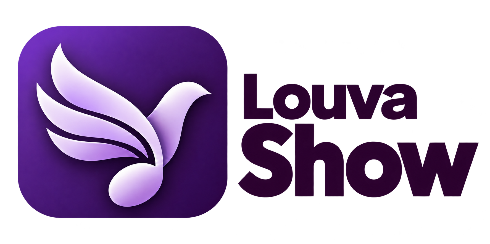

# Logos oficiais do LouvaShow

Estes são os quatro arquivos originais fornecidos para a identidade do LouvaShow. Os downloads abaixo entregam os PNGs, sem redesenho ou alteração de proporções.

| Estilo | Uso visual indicado | Download do PNG original |
| --- | --- | --- |
| Colorida para fundo claro | Cabeçalhos e materiais claros; símbolo colorido e nome escuro | [Baixar colorida · fundo claro](https://raw.githubusercontent.com/dantetesta/LouvaShow/main/src/shared/assets/logo-light.png) |
| Colorida para fundo escuro | Interface escura e materiais escuros; símbolo colorido e nome claro | [Baixar colorida · fundo escuro](https://raw.githubusercontent.com/dantetesta/LouvaShow/main/src/shared/assets/logo-dark.png) |
| Preta | Aplicação monocromática sobre fundo claro | [Baixar logo preta](https://raw.githubusercontent.com/dantetesta/LouvaShow/main/docs/brand/logo-black.png) |
| Branca | Aplicação monocromática sobre fundo escuro | [Baixar logo branca](https://raw.githubusercontent.com/dantetesta/LouvaShow/main/docs/brand/logo-white.png) |

O navegador pode exibir o PNG em vez de baixá-lo diretamente. Nesse caso, use **Salvar imagem como…**. A versão branca precisa de um fundo escuro para ser visualizada com contraste.

## Prévia adaptada ao tema

<picture>
  <source media="(prefers-color-scheme: dark)" srcset="../src/shared/assets/logo-dark.png">
  <source media="(prefers-color-scheme: light)" srcset="../src/shared/assets/logo-light.png">
  
</picture>

O README e o aplicativo usam a versão colorida adequada ao fundo. No aplicativo, a escolha **Claro/Escuro** fica em **Configurações → Aparência** e é salva neste computador, sem modificar a saída de projeção.

## Retrato nos créditos

O retrato de Dante Testa usado nos créditos foi produzido a partir de uma referência fornecida pelo autor. O aplicativo incorpora somente o retrato final autorizado; a imagem original de referência não faz parte do código público.

## Uso dos arquivos

Preserve as proporções originais, a legibilidade e o contraste. Estes arquivos identificam o projeto; sua disponibilidade para download não estabelece uma licença de marca nem autoriza sugerir parceria ou endosso.

Não foi definida uma licença separada para as logos. A licença do código do software também permanece pendente de escolha pelo mantenedor. As licenças dos textos bíblicos e outros materiais de terceiros continuam independentes; consulte seus avisos próprios.

[Voltar ao README](../README.md)
